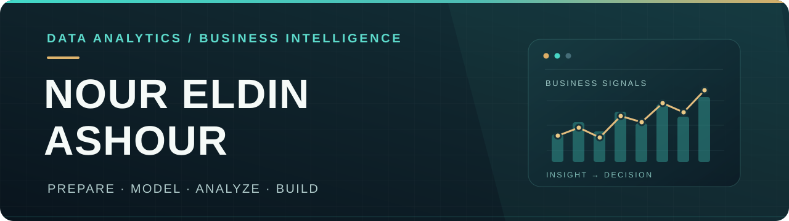

  

<h2 align="center">Data Analyst · Business Intelligence</h2>

Turning business data into reliable metrics, meaningful insights, and practical analytical solutions.

  
  
  
  
  
  

  
  
  
  
  
  

Core analytics tools · Databases · Development background · Python (currently developing)

---

I'm a Data Analyst focused on building end-to-end analytics solutions — from understanding business requirements and exploring data to cleaning, transforming, validating, and modeling datasets.

My work includes defining KPIs, developing interactive dashboards, analyzing business performance, and communicating actionable insights to support better decisions.

My projects cover **Retail & Sales Analytics, Customer Service Analytics, and Inventory Management**, with a strong focus on data quality, business logic, and analytical accuracy.

With a background in **Backend Development**, I also work on system design, database modeling, business workflows, and data integrity.

I'm continuously developing my skills in **Analytics Engineering and Data Engineering**, with an emphasis on reliable, scalable, and maintainable data solutions.

---

### Data Analytics & Business Intelligence
- **Power BI:** Power Query, Data Modeling, DAX Measures, Interactive Dashboards
- **Microsoft Excel:** Advanced Formulas, Power Query, Power Pivot, PivotTables, Reporting
- **Data Preparation:** Data Profiling, Cleaning, Transformation & Validation
- **Business Analytics:** EDA, KPI Definition, Performance Analysis & Reporting

### SQL & Databases
- **Databases:** Microsoft SQL Server, PostgreSQL
- **SQL:** Data Querying, Joins, Aggregations & Relational Data Modeling
- **Database Engineering:** Schema Design, Constraints, Data Integrity & Versioned SQL Migrations

### Backend & Systems Development
- **Technologies:** TypeScript, JavaScript, Node.js, NestJS
- **System Design:** Business Rules, Workflow Design & REST APIs
- **Development Tools:** GitHub, Docker

### Currently Learning
- Python for Data Analysis (foundational level)
- Analytics Engineering & Data Engineering

---

### CENTRIVA — Retail Intelligence Dashboard
**Power BI | Power Query | DAX | Retail Analytics**

A business intelligence project investigating retail performance, revenue growth, customer activity, product performance, profitability, and returns.

- Analyzed revenue growth drivers and store-level contributions.
- Explored customer cohorts, markets, products, and brands.
- Developed interactive reports and business-focused insights.
- Distinguished supported findings from assumptions that required further evidence.

### SALLA — Call Center Performance Analytics
**Power BI | Power Query | DAX | Data Modeling**

An analytical project evaluating call center performance, response timeliness, and service efficiency across three projects.

- Prepared, validated, and modeled operational data.
- Developed KPI measures, including a weighted Average Speed of Answer (ASA).
- Investigated unusual observations and compared performance under similar workloads.
- Produced analytical findings and recommendations.

### Inventory Management System
**PostgreSQL | NestJS | TypeScript | System Design**

*In Development*

An operational inventory management system designed around business workflows, data integrity, and traceable inventory movements.

- Analyzed inventory processes and defined business rules.
- Designed workflows, engineering contracts, and the relational data model.
- Developed PostgreSQL schemas and versioned SQL migrations.
- Designed the separation between historical stock movements and current inventory balances.
- Backend implementation is collaborative and follows the defined system contracts.

*Project pages and interactive reports will be linked here once the portfolio is published.*

---

I'm open to freelance projects and remote opportunities in Data Analytics, Business Intelligence, and related data solutions.

Feel free to connect with me on LinkedIn through the link on my GitHub profile.
